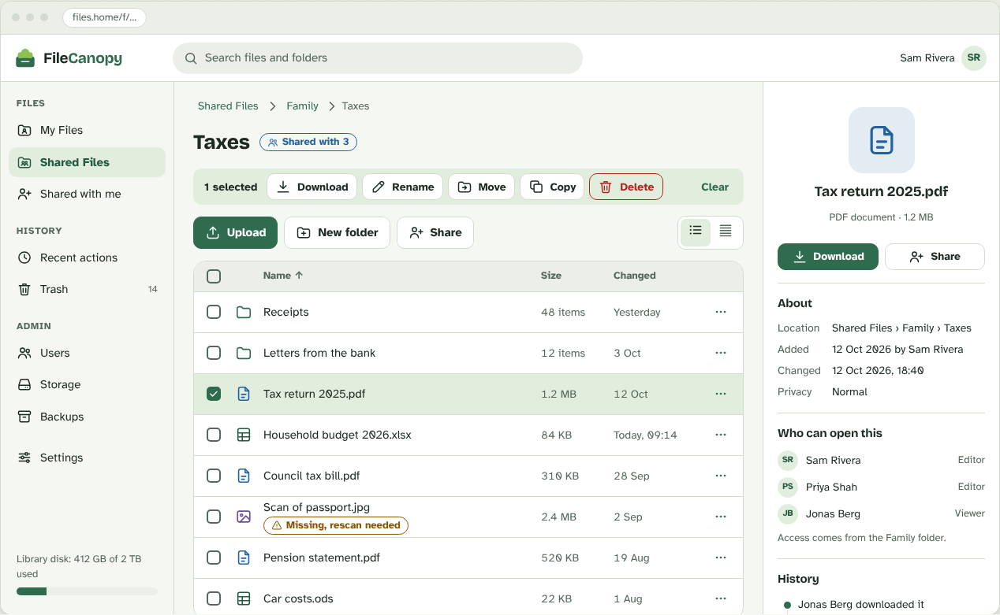

# FileCanopy

**A self-hosted file library built around AI: let AI organize your files, search them by meaning and answer questions about them, while everything stays as normal files in a folder you own.**

[](site/index.html)

*Design preview of the interface.*

FileCanopy runs on your own server with Docker and works on ordinary folders on your disk. Connect an AI provider, a cloud one or a model running on your own network, and your library starts to help you. Your files are never converted, hidden or locked in, so you can always open them with any other program.

- **AI that organizes for you.** Ask for a better name and the right folder for a file, split a long PDF into its real documents, find duplicates, and group files into collections. AI only proposes; nothing changes until you press Apply.
- **Chat with your files.** Ask a question and get an answer written from your own documents, with the source files listed so you can check them.
- **Search by meaning.** Run a local embedding model such as EmbeddingGemma on your own hardware and find "the holiday trip note" without remembering its name. Nothing leaves your network.
- **Local or cloud, your choice.** Use Anthropic, OpenAI or Gemini with monthly spending caps, or Ollama and llama.cpp at no cost. Private and Confidential files never go to a cloud AI.
- **Your AI tools can connect too.** An optional read-only MCP endpoint lets an AI assistant look at the files it is allowed to see.
- **Built for sharing safely.** Personal and shared folders with viewer and editor access, trash, undo and an activity log. Administrators cannot open anyone's personal files.

*FileCanopy also runs without an AI provider, if you prefer.*

## Install in three steps

You need Docker with Docker Compose v2.24 or newer. Nothing is built on your machine, and there is no password to choose.

1. Download the Compose file:

   ```bash
   mkdir filecanopy && cd filecanopy
   curl -fsSLO https://raw.githubusercontent.com/Aulteran/FileCanopy/HEAD/deploy/compose.yaml
   ```

2. Start it:

   ```bash
   docker compose up -d --wait
   ```

3. Open **http://127.0.0.1:8080**, enter the setup token from `docker compose logs api | grep "SETUP TOKEN"`, and create your administrator account.

Your files are ordinary files in the `library/` folder next to `compose.yaml`.

**Then turn on AI:** as an administrator, add a provider in the AI settings. The [AI guide](docs/guides/ai.md) covers cloud keys, local models and [semantic search](docs/guides/semantic-search.md).

**[Read the documentation](docs/README.md)** for configuration, remote access, backups and updating.

## What's included

- **AI:** organization proposals, PDF splitting, duplicate and collection suggestions, document chat, optional local semantic search, cloud (Anthropic, OpenAI, Gemini) or local (Ollama, llama.cpp) providers, usage caps, and an optional read-only MCP endpoint
- Personal and shared folders with viewer and editor access; accounts, invitations, password reset, optional single sign-on (OpenID Connect, Google)
- Upload, download, rename, move, copy, trash, undo and an activity log
- Import an existing folder or zip during first setup, and detection of changes made outside the app
- Private and Confidential labels with a re-authentication lock
- Previews, full-text search and optional OCR; optional encrypted backups and email intake

## Known limits

- This is a **public beta**. There is no stable release yet and no external security audit. Keep your own backups.
- Docker is the supported way to run it, and the beta images are built for amd64 only. Proxmox LXC is not available yet.
- Anyone who can read the server's disk can read the library, like any other folder. Private and Confidential labels control access in the app; they are not encryption at rest.
- Restoring a single file from an in-app backup is not built yet.
- The screenshots are design previews while the interface is being finished.

See the full [known issues](docs/release/known-issues.md) and [roadmap](docs/roadmap.md).

## Contributing, security and license

Bug reports and ideas are welcome in [GitHub issues](https://github.com/Aulteran/FileCanopy/issues); see the [developer guide](docs/development.md). Report vulnerabilities privately as described in [SECURITY.md](SECURITY.md). FileCanopy is licensed under the [AGPL-3.0](LICENSE).
